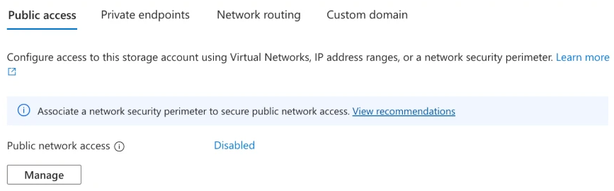
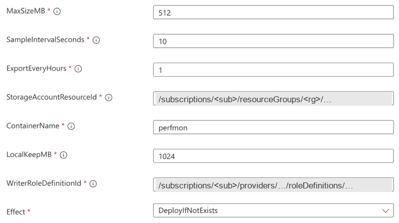
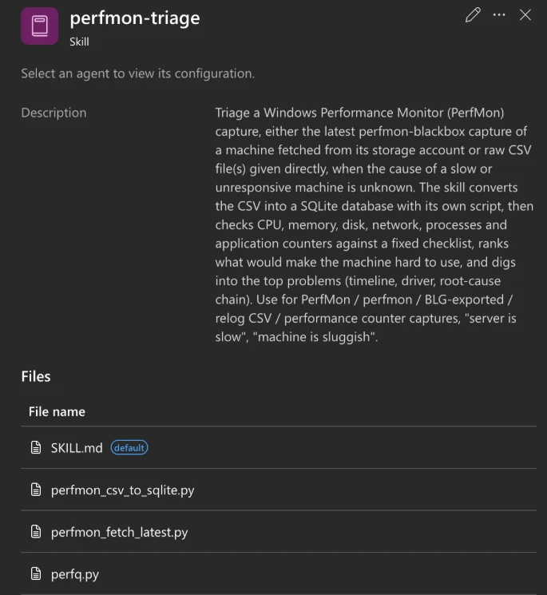
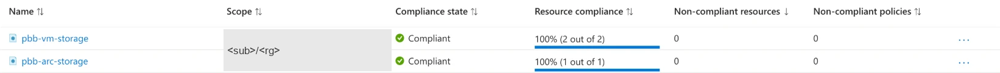
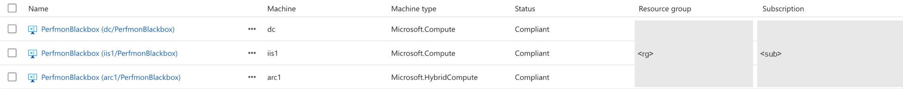
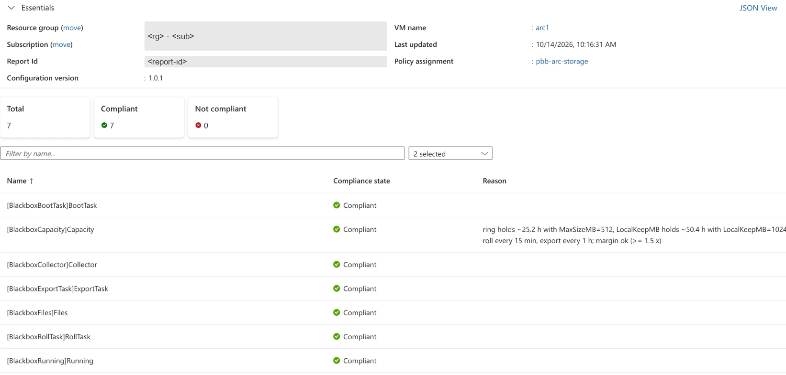
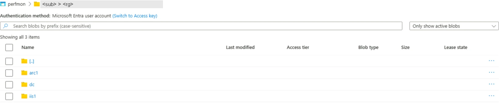
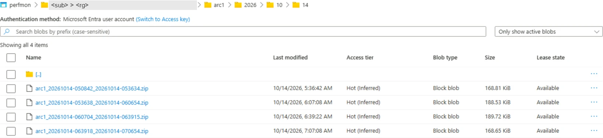

[Bölüm 1](), gece 03:10'da yavaşlayan ve sabaha iz bırakmayan bir sunucuyla başladı. O ana ait performans verisi
yoksa kök neden tahmin etmekten öteye geçemez. Microsoft'un operasyon ekipleri için geliştirdiği yapay zekâ agent'ı
Azure SRE Agent böyle bir anı inceleyebilir, ama ancak veri varsa. Bu bölümde verinin hazır olmasını sağlıyoruz.

Bu seride **Windows sunucular için bir kara kutu** kuruyoruz: uçaklardaki kara kutu gibi sürekli kayıt alan, yakın
geçmişi diskte tutan ve istendiğinde teslim eden bir kayıt sistemi. Seri dört bölümden oluşuyor ve tek bir hikâye
anlatıyor:

1. **[Bölüm 1](): neden kara kutu.** Sorundan sonra toplanmaya başlanan veri zaman ve emek ister; önceden çalışan bir
   kara kutu ve onu okuyabilen bir uzman bu yükü ortadan kaldırır.
2. **Bölüm 2 (bu yazı): kurulum.** Azure Policy ve Machine Configuration kara kutuyu her sunucuya yerleştirir, veri
   özel depolamaya taşınır. Adım adım, maliyetiyle birlikte.
3. **[Bölüm 3](): makinenin içi.** Kayıt sunucuda nasıl tutulur, sunucu yeniden başladığında ya da disk dolduğunda ne
   olur, sunucu kaydı kendi kimliğiyle nasıl yükler.
4. **[Bölüm 4](): agent olayı inceliyor.** Azure SRE Agent bir kaydı okur ve makineyi neyin zor kullanılır hâle
   getirdiğini açıklar.

Buradaki her şey açık kaynak bir playbook'a dayanıyor:
[VezirOrg/sreagent-playbook, `playbooks/perfmon-blackbox`](https://github.com/VezirOrg/sreagent-playbook/tree/perfmon-blackbox/v1.0.1/playbooks/perfmon-blackbox),
sürüm **[perfmon-blackbox/v1.0.1](https://github.com/VezirOrg/sreagent-playbook/releases/tag/perfmon-blackbox/v1.0.1)**.

✅ = lab'imizde doğrulandı · 📄 = yalnızca belgelere dayanıyor (Microsoft Learn, playbook'un dokümanları, Azure
fiyatları), biz test etmedik · 🔎 = lab'imiz dışındaki bir kurulumda görüldü, biz yeniden denemedik.
Admin makinesindeki her komut iki sekmede veriliyor. zsh sekmesindekileri playbook'taki hâliyle biz çalıştırdık. ✅
PowerShell sekmesi Windows için bizim uyarlamamız, biz çalıştırmadık; Windows PowerShell 5.1 ya da PowerShell 7 ile
kullanılabilir. 📄

## Amaç ve hedef kitle

**Amaç.** Bu yazının sonunda, seçtiğiniz kapsamdaki her Windows sunucu sürekli PerfMon kaydı alıyor ve birkaç saatte
bir son kaydı zip olarak özel bir depolama hesabındaki kendi klasörüne yüklüyor olacak. SRE Agent'ınızda da bu
zip'leri okuyabilen bir skill bulunacak. Sunuculara bizden hiçbir şey kurulmuyor.

**Hedef kitle.** Windows sunucularını Azure VM ya da Arc'a bağlı sunucu olarak yöneten Azure yöneticileri ve
SRE'ler. Azure Policy atamalarını ve rol atamalarını bilmeniz, Azure CLI kullanabilmeniz yeterli. Machine
Configuration'ı önceden bilmeniz gerekmiyor; gereken kısmı yazıda anlatıyoruz.

## Ön koşullar

| Ne | Neden | |
|---|---|---|
| Windows Server 2016 ya da üstü | kara kutu yalnızca Windows'un kendi araçlarını kullanır: Windows PowerShell 5.1, `logman`, `relog`, `schtasks` | 📄 (biz Windows Server 2022 ile çalıştırdık ✅) |
| Azure VM'ler: yerleşik initiative *Deploy prerequisites to enable Guest Configuration policies on virtual machines* | her VM'e system-assigned identity ve Machine Configuration extension'ını verir | ✅ |
| Arc'a bağlı sunucular: Connected Machine agent 1.10 ya da üstü | Machine Configuration'ı ve kimliği bu agent sağlar | 📄 (biz 1.68 ile çalıştırdık ✅) |
| Depolama için, sunuculardan adı çözümlenebilen bir private endpoint | yüklemeler private endpoint üzerinden `<account>.blob.core.windows.net` adresine, 443 portundan gider | ✅ |
| **SRE Agent'ta VNet integration**, aynı private endpoint'in adını çözebilecek şekilde | bu olmadan skill tek bir kaydı bile okuyamaz | ✅ |
| Kurulumu yapanın yetkisi: **abonelikte Owner** | policy tanımları için **abonelik** kapsamında Owner ya da Resource Policy Contributor gerekir; atamalar ve bunlara ait rol atamaları için makinelerin kaynak grubunda ve depolamada Owner ya da Resource Policy Contributor + User Access Administrator gerekir; kaynak grubunda Owner olmak tek başına yetmez, Contributor + Role Based Access Control Administrator da tanım ya da atama oluşturamaz ([deploy.md, prerequisites](https://github.com/VezirOrg/sreagent-playbook/blob/main/playbooks/perfmon-blackbox/docs/deploy.md#prerequisites); [Learn](https://learn.microsoft.com/azure/governance/policy/overview#azure-rbac-permissions-in-azure-policy)) | 📄 |
| Admin makinesinde: Azure CLI, Python 3, git; Windows'ta ayrıca bir bash (Git Bash ya da WSL) | policy tanımlarını Python üretir; skill yükleme betiği bash ile yazılmış | ✅ |

## Kısaca kara kutu

Akış şemasının tamamını [bölüm 1]() adım adım anlatıyor; burada kısa bir özetini veriyoruz. Her sunucuda **dairesel,
ikili bir PerfMon kaydı** (playbook'ta *ring*) sürekli çalışır: varsayılan olarak 512 MB ve 10 saniyede bir örnek. En
yeni veri en eskisinin üzerine yazıldığı için disk dolmaz. 📄 Sunucu birkaç saatte bir (varsayılan 4 saat) son dışa
aktarımdan bu yana biriken her şeyi dışa aktarır: bir CSV ve her boşluğu adıyla yazan bir manifest, tek bir zip
içinde. Zip'i **kendi managed identity'siyle**, özel bir depolama hesabındaki **kendi klasörüne** yükler. SRE Agent siz
sorduğunuzda kaydı oradan okur. ✅ Kara kutuyu her sunucuya Azure Policy ve Machine Configuration yerleştirir ve orada
tutar; sunucuya bizden hiçbir şey kurulmaz. 📄 Kaydın sunucunun içinde nasıl işlediği [bölüm 3'ün]()
konusu.

**Kısaca kurulum.** (1) Anahtarı ve public erişimi olmayan özel bir depolama hesabı. (2) Paketi taşıyan iki policy
tanımı. (3) Yalnızca gereken yetkilerle yapılan atamalar ve ardından bir remediation. (4) SRE Agent'ınızda analiz
skill'i.

## Lab'imiz

Kurulumu üç sunucuda yaptık. Ekran görüntülerindeki adlar lab'deki gerçek adlar:

- **dc** ve **iis1**: Windows Server 2022 çalışan Azure VM'ler. Playbook'un dokümanlarında IIS sunucusunun adı `vm1`;
  bizdeki iis1 ile aynı rolde.
- **arc1**: Arc'a bağlı bir sunucu. Arc tarafını şirket içinde bir makine olmadan test edebilmek için Learn'deki
  *Evaluate Azure Arc-enabled servers on an Azure VM* sayfasına göre hazırlanmış bir Azure VM. Azure metadata uç noktası
  (IMDS) engellendiği için yüklemeyi gerçekten Arc agent'ının uç noktası (HIMDS) üzerinden yapıyor.

Üç sunucu da paketi kendi depolamamızdaki bir container'dan aldı (playbook'taki "storage mode", aşağıda adım 2b); bu
yüzden sunucuların paket için internete çıkması gerekmedi. ✅ Paketin doğrudan GitHub release'inden alındığı diğer
modu playbook bir Azure VM'de ve Arc'a bağlı bir sunucuda test etti (T20b ve T20d testleri). 📄

## Adım adım kurulum

Temel kaynak, sürümün kurulum rehberi:
[v1.0.1'deki deploy.md](https://github.com/VezirOrg/sreagent-playbook/blob/perfmon-blackbox/v1.0.1/playbooks/perfmon-blackbox/docs/deploy.md).
Burada rehberin tek abonelik için anlattığı yolu kısaltarak veriyoruz. Yer tutucular `<…>` içinde.



```bash
git clone --branch perfmon-blackbox/v1.0.1 https://github.com/VezirOrg/sreagent-playbook.git
cd sreagent-playbook/playbooks/perfmon-blackbox
```


```powershell
git clone --branch perfmon-blackbox/v1.0.1 https://github.com/VezirOrg/sreagent-playbook.git
cd sreagent-playbook/playbooks/perfmon-blackbox
```



### Adım 0: Machine Configuration ön koşulları (Azure VM'ler, kapsam başına bir kez)

Bu adımı abonelikte Owner yetkisi olan bir operatör çalıştırır. Playbook'ta yazdığı gibi initiative'in kendi
kimliğine kapsamda Contributor rolü verilir; her VM'e kimliği ve extension'ı ekleyebilmesi için bu rol gerekir.



```bash
prereq=$(az policy set-definition list --query "[?displayName=='Deploy prerequisites to enable Guest Configuration policies on virtual machines'].name | [0]" -o tsv)
az policy assignment create -n gc-prereq --policy-set-definition "$prereq" --scope <scope> --mi-system-assigned --location <region>
pp=$(az policy assignment show -n gc-prereq --scope <scope> --query identity.principalId -o tsv)
az role assignment create --assignee-object-id $pp --assignee-principal-type ServicePrincipal --role Contributor --scope <scope>
for ref in $(az policy set-definition show -n "$prereq" --query "policyDefinitions[].policyDefinitionReferenceId" -o tsv); do
  az policy remediation create -n "gc-prereq-$ref" --policy-assignment gc-prereq --definition-reference-id "$ref" -g <rg> \
    --resource-discovery-mode ReEvaluateCompliance
done
```


```powershell
$prereq = az policy set-definition list --query "[?displayName=='Deploy prerequisites to enable Guest Configuration policies on virtual machines'].name" -o tsv |
  Select-Object -First 1
az policy assignment create -n gc-prereq --policy-set-definition $prereq --scope <scope> --mi-system-assigned --location <region>
$pp = az policy assignment show -n gc-prereq --scope <scope> --query identity.principalId -o tsv
az role assignment create --assignee-object-id $pp --assignee-principal-type ServicePrincipal --role Contributor --scope <scope>
foreach ($ref in (az policy set-definition show -n $prereq --query "policyDefinitions[].policyDefinitionReferenceId" -o tsv)) {
  az policy remediation create -n "gc-prereq-$ref" --policy-assignment gc-prereq --definition-reference-id $ref -g <rg> `
    --resource-discovery-mode ReEvaluateCompliance
}
```



`--resource-discovery-mode ReEvaluateCompliance` önemli. Yeni bir atamanın henüz uyumluluk sonucu olmadığı için
sıradan bir remediation hiçbir kaynak bulamaz: "Succeeded" der ama 0 deployment yapar. ✅ Lab'imizde extension,
başladıktan yaklaşık 20 dakika sonra VM'e kurulmuştu. ✅ Arc'a bağlı sunucularda bu adım gerekmez.

### Adım 1: Özel depolama



```bash
az deployment group create -g <storage-rg> -f infra/main.bicep \
  -p storageAccountName=<name> \
     privateEndpointSubnetId=<an ordinary subnet for private endpoints, not a delegated one> \
     blobPrivateDnsZoneId=<resource ID of privatelink.blob.core.windows.net> \
     readerPrincipalIds='["<agent system identity object ID>","<agent user-assigned identity object ID>"]'
```


```powershell
'["<agent system identity object ID>","<agent user-assigned identity object ID>"]' | Set-Content reader-ids.json
az deployment group create -g <storage-rg> -f infra/main.bicep `
  -p storageAccountName=<name> `
     privateEndpointSubnetId=<an ordinary subnet for private endpoints, not a delegated one> `
     blobPrivateDnsZoneId=<resource ID of privatelink.blob.core.windows.net> `
     readerPrincipalIds=@reader-ids.json
```



Agent'ın iki kimliğinin object ID'lerini portalda agent kaynağının Identity sayfasında görebilir ya da
`az resource show --ids <agent resource ID> --query identity` ile alabilirsiniz. 📄

Sonuçta şunlar oluşur: **shared key'i kapalı**, **public network access'i Disabled** ve TLS 1.2 kullanan bir depolama
hesabı; 30 günlük lifecycle kuralı olan `perfmon` container'ı; private endpoint; iki custom rol (*PerfMon Blackbox
Writer*, *PerfMon Blackbox Deployer*) ve agent'ın iki kimliği için container'da okuma yetkisi. ✅ Bu adım yaklaşık
2 dakika sürdü. ✅ Üç çıktıyı not edin: `storageAccountResourceId`, `writerRoleDefinitionId` ve storage mode için `packageContainerResourceId`.



### Adım 2: Policy tanımları

Paketin URL'si ve SHA-256 değeri release notlarında yazar:

| | |
|---|---|
| paket | `https://github.com/VezirOrg/sreagent-playbook/releases/download/perfmon-blackbox%2Fv1.0.1/PerfmonBlackbox.zip` |
| SHA-256 | `806BCADB69F556401DE19754AEB649B7611EB1AE18AA106A5BF0A537A99363DD` |
| `--version` | `1.0.1` |



```bash
python3 policy/build_policies.py --content-uri <package URL> --content-hash <sha256> --version 1.0.1 --out policy/out
p() { python3 -c 'import json,sys; v=json.load(open(sys.argv[1]))["properties"][sys.argv[2]]; print(v if isinstance(v,str) else json.dumps(v))' "$1" "$2"; }
for kind in vm arc; do
  f=policy/out/perfmon-blackbox-$kind.json
  az policy definition create -n perfmon-blackbox-$kind --mode Indexed --display-name "$(p $f displayName)" \
    --rules "$(p $f policyRule)" --params "$(p $f parameters)" --metadata "$(p $f metadata)"
done
```


```powershell
python policy/build_policies.py --content-uri <package URL> --content-hash <sha256> --version 1.0.1 --out policy/out
foreach ($kind in 'vm', 'arc') {
  $f = "policy/out/perfmon-blackbox-$kind.json"
  python -c "import json,sys; d=json.load(open(sys.argv[1]))['properties']; [json.dump(d[k],open(sys.argv[2]+'-'+k+'.json','w')) for k in ('policyRule','parameters','metadata')]" $f $kind
  $name = (Get-Content $f -Raw | ConvertFrom-Json).properties.displayName
  az policy definition create -n "perfmon-blackbox-$kind" --mode Indexed --display-name $name `
    --rules "@$kind-policyRule.json" --params "@$kind-parameters.json" --metadata "@$kind-metadata.json"
}
```



`-vm` Azure VM'leri, `-arc` Arc'a bağlı sunucuları hedefler; yalnızca ihtiyacınız olanı oluşturun. **Dört parçanın
hepsini verin**: kurallar, parametreler, metadata ve görünen ad. Machine Configuration her sunucunun guest
assignment'ını tanımın `metadata.guestConfiguration` alanına göre oluşturur; metadata olmadan storage mode çalışmaz. ✅ 📄

### Adım 2b: Paket kendi depolamanızdan (isteğe bağlı)

**Storage mode**'da sunucular aynı zip'i özel depolamanızdaki bir container'dan kendi kimlikleriyle indirir; paket için
internete çıkmaları gerekmez. Release zip'ini hiç değiştirmeden `packages` container'ına kopyalayın (tanımdaki hash
başka bir dosyayı kabul etmez), sonra `-storage` tanımlarını üretin:



```bash
curl -sL -o PerfmonBlackbox.zip <package URL>
shasum -a 256 PerfmonBlackbox.zip            # must equal the SHA-256 above
# from a host inside the network, whose identity has Storage Blob Data Contributor on the packages container:
az storage blob upload --auth-mode login --account-name <account> -c packages -n PerfmonBlackbox.zip -f PerfmonBlackbox.zip --overwrite
python3 policy/build_policies.py --content-uri <package URL> --content-hash <sha256> --version 1.0.1 \
  --package-container-id <packageContainerResourceId> --out policy/out
# then create perfmon-blackbox-vm-storage / -arc-storage as in step 2 (name = file name)
```


```powershell
Invoke-WebRequest -Uri <package URL> -OutFile PerfmonBlackbox.zip
(Get-FileHash PerfmonBlackbox.zip -Algorithm SHA256).Hash   # must equal the SHA-256 above
# from a host inside the network, whose identity has Storage Blob Data Contributor on the packages container:
az storage blob upload --auth-mode login --account-name <account> -c packages -n PerfmonBlackbox.zip -f PerfmonBlackbox.zip --overwrite
python policy/build_policies.py --content-uri <package URL> --content-hash <sha256> --version 1.0.1 `
  --package-container-id <packageContainerResourceId> --out policy/out
# then create perfmon-blackbox-vm-storage / -arc-storage as in step 2 (name = file name)
```



Yüklemeyi ağın içinden yapın: hesabın public erişimi kapalı olduğundan dizüstü bilgisayarınız ya da bulutta çalışan
(hosted) bir CI runner hesaba erişemez. `main.bicep`, `packages` üzerinde kimseye yazma yetkisi vermez; bu yetkiyi
yüklemeyi yapacak makineye siz verirsiniz.
Lab'imizde dc'nin kimliği yalnızca `packages` üzerinde Storage Blob Data Contributor aldı. ✅ Storage mode için Machine
Configuration agent'ı 1.29.98.0 ya da üstü olmalı. Azure VM'de sürümü
`C:\Packages\Plugins\Microsoft.GuestConfiguration.ConfigurationforWindows\` altındaki klasör adından okuyun (bizde
1.29.119.0); extension'ın `typeHandlerVersion` değeri (1.1) agent'ın değil handler'ın sürümüdür. ✅


**Aynı makineye iki modu birden atamayın.** İkisi de aynı guest assignment'ı (`PerfmonBlackbox`) yazar ve sürekli
birbirinin üzerine yazar. Mod değiştirmek için önce eski atamayı ve ona ait rol atamalarını kaldırın. 📄


### Adım 3: Atama, yetkiler ve remediation



```bash
az policy assignment create -n pbb-vm --policy perfmon-blackbox-vm --scope <scope> \
  --mi-system-assigned --location <region> \
  --params '{"StorageAccountResourceId":{"value":"<storageAccountResourceId>"},
             "WriterRoleDefinitionId":{"value":"<writerRoleDefinitionId>"}}'
pid=$(az policy assignment show -n pbb-vm --scope <scope> --query identity.principalId -o tsv)
```


```powershell
@'
{"StorageAccountResourceId":{"value":"<storageAccountResourceId>"},
 "WriterRoleDefinitionId":{"value":"<writerRoleDefinitionId>"}}
'@ | Set-Content pbb-params.json
az policy assignment create -n pbb-vm --policy perfmon-blackbox-vm --scope <scope> `
  --mi-system-assigned --location <region> --params "@pbb-params.json"
$mi = az policy assignment show -n pbb-vm --scope <scope> --query identity.principalId -o tsv
```



Storage mode'da `--policy perfmon-blackbox-vm-storage` ve ayrı bir atama adı kullanılır (biz `pbb-vm-storage` ve
`pbb-arc-storage` adlarını kullandık). Sayısal parametreler **string** olarak verilir: `{"ExportEveryHours":{"value":"1"}}`.
JSON sayısı verirseniz `InvalidPolicyParameterType` hatası alırsınız. ✅ Bir saat içinde zip görebilmek için
`ExportEveryHours`'u `"1"` yaptık; varsayılan değer 4.



**Kim hangi yetkiyi alıyor.** Atamayı operatör olarak siz oluşturursunuz. Atamanın **kimliği** ise tam olarak dört rol
alır:

- kapsamda *Guest Configuration Resource Contributor* ve *Reader*,
- depolama kaynak grubunda *PerfMon Blackbox Deployer*,
- depolama hesabında **koşullu** *Role Based Access Control Administrator*: bu rolle yalnızca Writer rolünü (storage
  mode'da ayrıca paket container'ında yerleşik blob okuma rolünü) dağıtabilir.

deploy.md'nin 3. adımındaki dört komut: ✅



```bash
az role assignment create --assignee-object-id $pid --assignee-principal-type ServicePrincipal \
  --role "Guest Configuration Resource Contributor" --scope <scope>
az role assignment create --assignee-object-id $pid --assignee-principal-type ServicePrincipal \
  --role Reader --scope <scope>
az role assignment create --assignee-object-id $pid --assignee-principal-type ServicePrincipal \
  --role "PerfMon Blackbox Deployer" --scope <storage resource group ID>
w=<last segment of writerRoleDefinitionId>
az role assignment create --assignee-object-id $pid --assignee-principal-type ServicePrincipal \
  --role "Role Based Access Control Administrator" --scope <storageAccountResourceId> --condition-version 2.0 \
  --condition "((!(ActionMatches{'Microsoft.Authorization/roleAssignments/write'})) OR (@Request[Microsoft.Authorization/roleAssignments:RoleDefinitionId] ForAnyOfAnyValues:GuidEquals {$w, 2a2b9908-6ea1-4ae2-8e65-a410df84e7d1})) AND ((!(ActionMatches{'Microsoft.Authorization/roleAssignments/delete'})) OR (@Resource[Microsoft.Authorization/roleAssignments:RoleDefinitionId] ForAnyOfAnyValues:GuidEquals {$w, 2a2b9908-6ea1-4ae2-8e65-a410df84e7d1}))"
```


```powershell
az role assignment create --assignee-object-id $mi --assignee-principal-type ServicePrincipal `
  --role "Guest Configuration Resource Contributor" --scope <scope>
az role assignment create --assignee-object-id $mi --assignee-principal-type ServicePrincipal `
  --role Reader --scope <scope>
az role assignment create --assignee-object-id $mi --assignee-principal-type ServicePrincipal `
  --role "PerfMon Blackbox Deployer" --scope <storage resource group ID>
$w = '<last segment of writerRoleDefinitionId>'
$cond = "((!(ActionMatches{'Microsoft.Authorization/roleAssignments/write'})) OR (@Request[Microsoft.Authorization/roleAssignments:RoleDefinitionId] ForAnyOfAnyValues:GuidEquals {$w, 2a2b9908-6ea1-4ae2-8e65-a410df84e7d1})) AND ((!(ActionMatches{'Microsoft.Authorization/roleAssignments/delete'})) OR (@Resource[Microsoft.Authorization/roleAssignments:RoleDefinitionId] ForAnyOfAnyValues:GuidEquals {$w, 2a2b9908-6ea1-4ae2-8e65-a410df84e7d1}))"
az role assignment create --assignee-object-id $mi --assignee-principal-type ServicePrincipal `
  --role "Role Based Access Control Administrator" --scope <storageAccountResourceId> --condition-version 2.0 `
  --condition $cond
```



`2a2b9908-6ea1-4ae2-8e65-a410df84e7d1`, yerleşik *Storage Blob Data Reader* rolünün kimliğidir ve her tenant'ta
aynıdır. Atamayı portalda oluşturduysanız, kimliğin adı atamanın görünen adı değil, atamanın iç kimliği olur: object
ID'yi atamanın *Managed Identity* sekmesinden (Principal ID) alın. Ardından bir dakika bekleyip remediation'ı
çalıştırın:



```bash
az policy remediation create -n pbb-vm-1 --policy-assignment pbb-vm -g <rg> \
  --resource-discovery-mode ReEvaluateCompliance        # per resource group in scope
```


```powershell
az policy remediation create -n pbb-vm-1 --policy-assignment pbb-vm -g <rg> `
  --resource-discovery-mode ReEvaluateCompliance        # per resource group in scope
```



Aynısını `perfmon-blackbox-arc` (`pbb-arc`) için tekrarlayın. Policy her sunucu için `PerfmonBlackbox` guest
assignment'ını ve Writer rolü için **tek** bir rol ataması oluşturur. **Sunucu kayıtları okuma yetkisi almaz**; yazma
yetkisi de bir yol şartına bağlıdır: yalnızca `<sub>/<rg>/<server>/` altına yazabilir. ✅ Playbook'un dokümanlarına
göre sunucu paketi remediation'dan sonra yaklaşık bir saat içinde uygular (ilk döngüde yalnızca kontrol eder,
sonrakinde uygular). 📄 Lab'imizde iis1 atamadan 31 dakika sonra Compliant oldu. ✅

### Adım 4: SRE Agent'ınızdaki skill



```bash
SRE_AGENT_ID=<agent resource ID> scripts/deploy-skill.sh skill/perfmon-triage            # dry run
SRE_AGENT_ID=<agent resource ID> scripts/deploy-skill.sh skill/perfmon-triage --apply    # create or update
```


```powershell
# deploy-skill.sh is a bash script; on Windows run it with Git Bash's bash.exe or in WSL
$env:SRE_AGENT_ID = '<agent resource ID>'
bash scripts/deploy-skill.sh skill/perfmon-triage            # dry run
bash scripts/deploy-skill.sh skill/perfmon-triage --apply    # create or update
```



Betiği çalıştıranın agent üzerinde **SRE Agent Author** ve **SRE Agent Standard User** rolleri olmalı; Administrator
gerekmez. ✅ Learn'deki SRE Agent MCP server sayfası, data plane'deki skill işlemleri için **SRE Agent Administrator**
rolünü gösteriyor; bizim yüklememiz bu rol olmadan çalıştı. 📄 Betik agent'ın data plane API'sini kullanır, çünkü
skill'ler için ARM kaynağı bizim tenant'ımızda "internal tenants only" yanıtını verdi. ✅ Dry run ve apply 14 saniye
sürdü; öncesinde rol atamasının etkinleşmesi için yaklaşık 10 dakika beklemek gerekti. ✅



## Doğrulama

**1. Policy görünümü.** *Policy → Compliance* sayfasında iki atama da Compliant: iki Azure VM ve bir Arc'a bağlı
sunucu. ✅



**2. Guest assignment'lar.** Üç sunucu tek listede, Azure VM'ler (`Microsoft.Compute`) ve Arc (`Microsoft.HybridCompute`)
yan yana. ✅



Ya da CLI'dan:



```bash
az rest --method get --url "https://management.azure.com<server ID>/providers/Microsoft.GuestConfiguration/guestConfigurationAssignments/PerfmonBlackbox?api-version=2024-04-05" --query properties.complianceStatus
```


```powershell
az rest --method get --url "https://management.azure.com<server ID>/providers/Microsoft.GuestConfiguration/guestConfigurationAssignments/PerfmonBlackbox?api-version=2024-04-05" --query properties.complianceStatus
```



**3. Bir sunucuya yakından bakış.** arc1'in guest assignment'ı: yapılandırma sürümü 1.0.1, yedi kaynağın yedisi de
Compliant. Kapasite kaynağı tahminini Reason sütununa yazar: 512 MB'lık dairesel dosya arc1'in yaklaşık 25,2 saatlik
verisini, yerel tampon yaklaşık 50,4 saatlik verisini tutuyor; güvenlik payı yeterli. ✅ Aynı kontrol iis1'de yaklaşık
22,4 saat gösterdi: bu değer en çok süreç sayısına bağlı. ✅ Veri sığmasaydı bu kaynak, daha veri kaybolmadan
NonCompliant olurdu. 📄



**4. İlk zip'ler.** Container'da her sunucu için bir klasör var: ✅



arc1'in o güne ait klasöründe de saatte bir zip var, her biri 168 ile 190 KiB arasında: ✅



Portal blob'ları yalnızca ağın içinden listeleyebilir; biz VNet'teki bir VM'de (Bastion üzerinden) açtığımız bir
tarayıcıyı kullandık. Dışarıdan bakıldığında hesap hiç veri döndürmez; istenen de zaten bu. ✅

## Klasör düzeni ve gerekçesi

Her zip şu yola yazılır:

```text
perfmon/<sub>/<rg>/<server>/yyyy/MM/dd/<server>_<startUTC>_<endUTC>.zip
```

Örneğin `perfmon/<sub>/<rg>/arc1/2026/10/14/arc1_20261014-063918_20261014-070654.zip`. ✅ Yolun her parçasının bir
görevi var:

- **`<sub>/<rg>/<server>/` sunucunun kendi önekidir** ve sunucunun kaynak kimliğinden türetilir. Writer rolünün şartı
  bunu denetler: sunucu yalnızca kendi önekinin altına yazabilir, başka bir sunucunun klasörüne asla. ✅ Yoldaki abonelik ve
  kaynak grubu aynı adlı iki sunucuyu birbirinden ayırır. 📄
- **`yyyy/MM/dd/`** bir günün dosyalarını bir arada tutar: tek bir klasörü açınca o günün bütün dışa aktarımlarını
  görürsünüz (yukarıdaki ekran görüntüsündeki gibi).
- **Dosya adı zaman aralığını gösterir**: ilk ve son örneğin zamanı. Skill en yeni kaydı ya da bir zaman aralığını
  kapsayan zip'leri hiçbir zip'i açmadan, yalnızca listeye bakarak seçer. 📄
- 30 günlük lifecycle kuralı eski zip'leri, yolları ne olursa olsun yaşlarına göre siler. 📄

## Maliyeti

Fiyatlar [Azure Retail Prices API](https://learn.microsoft.com/rest/api/cost-management/retail-prices/azure-retail-prices)'den
alınmış liste fiyatlarıdır (USD), sorgu tarihi **2026-10-14**; fiyatın bölgeye göre değiştiği kalemlerde bölge
**Sweden Central**. Sizin anlaşmanızdaki fiyatlar farklı olabilir. 📄

**Kara kutunun maliyeti, sunucu ve kurulum başına:**

| Kalem | Fiyat | Burada anlamı |
|---|---|---|
| **Azure VM**'de Machine Configuration | dahil | 0 📄 |
| **Arc'a bağlı sunucuda** Machine Configuration ("Guest Configuration Policy/Server" ölçeri) | sunucu başına ayda 6,00 USD | **Arc sunucusu başına 6,00 USD** 📄 |
| Blob depolama, Hot LRS | GB başına ayda 0,0184 USD | 30 günlük kuralla sunucu başına yaklaşık 0,5 GB → **sunucu başına yaklaşık 0,01 USD** (yoğun bir sunucuda 0,03 USD) |
| Private endpoint (Standard) | saatte 0,01 USD | **kurulum başına ayda yaklaşık 7,30 USD**, bütün sunucular ortak kullanır 📄 |
| Yazma işlemleri, private endpoint veri işleme | 10.000 yazma başına 0,05 USD; GB başına 0,01 USD | sunucu başına 0,01 USD'nin altında 📄 |

Depolama hacmi playbook'un ölçümüne dayanıyor: yaklaşık 117 süreç ve 10 saniyelik aralıkla örnek başına yaklaşık
1,9 KB, yani sunucu başına günde yaklaşık 16 MB. 📄 arc1'in saatlik 168–190 KiB'lık zip'leri bununla uyumlu. ✅

**SRE Agent** Azure Agent Unit (AAU) ile ücretlendirilir ([Learn: pricing and billing](https://learn.microsoft.com/azure/sre-agent/pricing-billing)): 📄

| Kısım | Oran | USD (Sweden Central'da AAU başına 0,11) |
|---|---|---|
| Always-on flow: agent oluşturulduğu andan silinene kadar | agent-saat başına 4 AAU | saatte yaklaşık 0,44, **ayda yaklaşık 321** |
| Active flow: yapılan iş, örneğin bir analiz | modele göre milyon token başına AAU | aşağıda |

Always-on maliyeti kara kutuya değil agent'a aittir: ortam başına bir agent, bu işi diğer işleriyle birlikte yapar.
Yeni müşteriler agent'ı 30 gün boyunca always-on ücreti ödemeden deneyebilir. 📄

**Tek bir derin analiz.** Lab'imizde yapılan üç derin analizin her biri (ikisinde yükü bilerek biz oluşturduk; bölüm 4
bunlardan birini açıkça gösteriyor) yaklaşık 35 AAU harcadı. ✅ Learn'ün "incident investigation" için verdiği
örnek de yaklaşık 35,3 AAU. 📄

Yani **tek bir derin analiz, bölgeye göre kabaca 3,5–5 USD tutar**: Sweden Central'da yaklaşık 3,9 USD (35 × 0,11).
AAU başına fiyat ("SRE Agent Unit", Retail Prices API, 2026-10-14): 📄

| Bölgeler (örnek) | AAU başına USD | Tek analiz (yaklaşık 35 AAU) |
|---|---|---|
| East US, East US 2, West US 2, Central US | 0,10 | yaklaşık 3,5 USD |
| Sweden Central, UK South, Australia East | 0,11 | yaklaşık 3,9 USD |
| West Europe, North Europe | 0,136 | yaklaşık 4,8 USD |

**Örnek hesap**, aylık, Sweden Central:

| | 10 sunucu | 100 sunucu |
|---|---|---|
| Azure VM'ler: Machine Configuration | 0 | 0 |
| Bunun yerine Arc'a bağlı sunucular: Machine Configuration | 60,00 USD | 600,00 USD |
| Depolama (sunucu başına 0,01–0,03 USD) | 0,10–0,30 USD | 1–3 USD |
| Private endpoint (kurulum başına bir tane) | 7,30 USD | 7,30 USD |
| **Kara kutu toplamı, Azure VM'ler** | **yaklaşık 7,50 USD** | **yaklaşık 8–10 USD** |
| **Kara kutu toplamı, Arc'a bağlı sunucular** | **yaklaşık 67,50 USD** | **yaklaşık 608–610 USD** |
| SRE Agent always-on (henüz agent'ınız yoksa) | yaklaşık 321 USD | yaklaşık 321 USD |
| Her derin analiz | yaklaşık 3,9 USD | yaklaşık 3,9 USD |

Azure VM'lerde kara kutunun maliyeti neredeyse sıfır; maliyetin büyük kısmı private endpoint'ten geliyor. Arc'ta ise
maliyetin çoğu Machine Configuration'ın sunucu başına ücreti; ancak Arc sunucularınız zaten bir lisansla kapsanıyorsa
durum değişir: Windows Server
Software Assurance (attestation ile) ya da Windows Server pay-as-you-go, Azure Machine Configuration'ı ek ücret
olmadan içerir
([Learn: Windows Server Management enabled by Azure Arc](https://learn.microsoft.com/azure/azure-arc/servers/windows-server-management-overview)). 📄

## Sınırlar

- **Bu bir topluluk playbook'u, Microsoft ürünü değil.** Lab'imizde test ettik ([playbook'un
  testleri](https://github.com/VezirOrg/sreagent-playbook/blob/perfmon-blackbox/v1.0.1/playbooks/perfmon-blackbox/docs/tests.md));
  üretim sunucularına atamadan önce kodu okuyun.
- **Yalnızca Windows.** Tanımlar Windows Azure VM'lerini ve Windows çalışan Arc'a bağlı sunucuları hedefler. 📄
- **Adlar tekil olmak zorunda.** İki custom rolün adı bütün Microsoft Entra tenant'ında, policy tanımlarının adları da
  abonelikte benzersiz olmalı. İkinci bir kurulum için farklı adlar gerekir (deploy.md, "Names"). 📄
- **Kaldırma** adımları belgelenmiş (atamalar, rol atamaları, tanımlar, custom roller, depolama):
  [operations.md, Remove](https://github.com/VezirOrg/sreagent-playbook/blob/perfmon-blackbox/v1.0.1/playbooks/perfmon-blackbox/docs/operations.md#remove). 📄

## Sorun giderme

| Belirti | Neden | Çözüm |
|---|---|---|
| Remediation "Succeeded", 0 deployment | yeni bir atamanın henüz uyumluluk sonucu yok | `--resource-discovery-mode ReEvaluateCompliance` ✅ |
| Atamada `InvalidPolicyParameterType` | sayısal parametre JSON sayısı olarak verilmiş | string verin: `{"value":"1"}` ✅ |
| Storage mode: guest assignment GitHub'ı gösteriyor ya da indirme başarısız | tanım metadata'sı olmadan oluşturulmuş | `--metadata` ve `--display-name` ile oluşturun (adım 2) ✅ |
| Storage mode: mod değişiminin hemen ardından paket indirmesinde HTTP 403 | sunucunun `packages` üzerindeki okuma rolü henüz verilmemiş | remediation'ın vermesini bekleyin 📄 |
| Guest assignment `[BlackboxCapacity]` üzerinde NonCompliant kalıyor | dairesel dosya ya da yerel tampon, dışa aktarım aralığının 1,5 katını tutamıyor | `LocalKeepMB` ya da `MaxSizeMB`'ı artırın veya daha sık dışa aktarın 📄 |
| Skill bir kaydı listeleyemiyor ya da okuyamıyor | agent'ta VNet integration yok ya da private endpoint'in adını çözemiyor | private DNS çözümlemesi olan bir VNet integration (ön koşullar) 📄 |
| Agent'ın terminali container'da 403 alıyor | okuma rolü yalnızca agent'ın user-assigned kimliğine verilmiş, oysa terminal system-assigned kimliğiyle oturum açıyor | `readerPrincipalIds`'e iki kimliği de verin (adım 1) ✅ |

## Sıfırdan kurulum ne kadar sürdü

Playbook'un ikinci lab'inde kurulum, ürünü hiç bilmeyen birinin gözüyle yapıldı: yalnızca README ve deploy.md
kullanıldı. Aşağıdakiler, v1.0.0'ın 2026-10-13'te iis1 üzerindeki bu kurulumunun süreleri. ✅ v1.0.1 aynı paketi
kullanır (aynı SHA-256); yalnızca üretilen policy tanımları ve dokümanlar değişti. 📄

| Adım | Geçen süre |
|---|---|
| 0 Machine Configuration ön koşulları → VM'de kimlik ve extension | yaklaşık 20 dk |
| 1 `main.bicep` | yaklaşık 2 dk |
| 2 ve 2b tanımlar, paketin depolamaya yüklenmesi | yaklaşık 1,5 dk |
| 3 atama, roller, remediation → guest assignment Compliant | yaklaşık 31 dk |
| depolamadaki ilk zip (`ExportEveryHours` = 1) | Compliant'tan 29 dk sonra |
| 4 skill (dry run ve apply) | 14 sn |
| agent'ın ilk yanıtı | 6 dk 57 sn |

Bu kurulumda dokümanlarda yedi eksik de bulundu. Hepsi v1.0.1'de deploy.md ve parameters.md'de düzeltildi: ✅ 📄

| # | Karşılaştığımız | v1.0.1'deki düzeltme |
|---|---|---|
| F1 | yeni bir atamanın hemen ardından çalışan remediation 0 kaynak buldu | adım 0 ve adım 3'te `--resource-discovery-mode ReEvaluateCompliance` |
| F2 | `az policy definition create` yalnızca kuralları ve parametreleri geçiriyordu; metadata ve görünen ad kayboluyordu, storage mode ise metadata olmadan çalışmaz | adım 2 dört parçanın hepsini veriyor |
| F3 | adım 2b, yalnızca private endpoint'li bir hesaba paketi kimin yükleyebileceğini söylemiyordu | yükleyen makine ve ona verilen Blob Data Contributor yetkisi açıkça yazıldı |
| F4 | JSON sayısı olarak verilen `ExportEveryHours` `InvalidPolicyParameterType` hatası verdi | parameters.md: sayısal parametreler string |
| F5 | private endpoint için hangi subnet'in kullanılacağı ve storage mode için gereken üçüncü çıktı | adım 1'de adıyla yazıldı |
| F6 | şablon VM'lerinde system identity zaten vardı, yalnızca extension eksikti | düzeltilecek bir şey yok: adım bu durumu zaten karşılıyor |
| F7 | önerilen sürüm kontrolü agent'ın değil extension handler'ının sürümünü (1.1) döndürüyordu | sürüm artık klasör adından okunuyor |

Lab'imiz dışındaki ikinci bir sıfırdan kurulumda **dokümanlarda altı düzeltme daha bulduk**. Bunları yeniden
çalıştırmadık. D1 ve D4'ü Learn belgeliyor 📄, D5'i kendi lab'imizde gördük ✅, D2, D3 ve D6 ise yalnızca o
kurulumdan geliyor 🔎. Playbook'un deploy.md'si artık altısını da kapsıyor ([main dalında](https://github.com/VezirOrg/sreagent-playbook/blob/main/playbooks/perfmon-blackbox/docs/deploy.md)).

| # | Kurulumda karşılaşılan | Ne yapmalı |
|---|---|---|
| D1 | policy tanımlarını oluşturmak kaynak grubunda Owner ile başarısız oldu; Contributor + Role Based Access Control Administrator ise ne tanım ne atama oluşturabildi | tanımlar için **abonelik** kapsamında Owner ya da Resource Policy Contributor; atamalar ve rol atamaları için Owner ya da Resource Policy Contributor + User Access Administrator ([prerequisites](https://github.com/VezirOrg/sreagent-playbook/blob/main/playbooks/perfmon-blackbox/docs/deploy.md#prerequisites)) 📄 |
| D2 | portaldaki policy tanımı düzenleyicisinde oluşturulan tanımlarda `metadata.guestConfiguration` kayboldu; storage mode bu alan olmadan çalışmaz | tanımları CLI ile (adım 2) ya da üretilen dosyanın REST PUT'u ile oluşturun, sonra `metadata.guestConfiguration`'ın boş olmadığını kontrol edin ([3b, portal route](https://github.com/VezirOrg/sreagent-playbook/blob/main/playbooks/perfmon-blackbox/docs/deploy.md#3b-portal-route)) 🔎 |
| D3 | portalda oluşturulan bir atamanın kimliği, atamanın adıyla aranınca bulunamadı: kimliğin adı bir GUID | kimliği principal ID'siyle bulun (atama → *Managed Identity*). Portal ayrıca bütün atama kapsamında **koşulsuz** bir Role Based Access Control Administrator rolü verir: adım 3'teki koşullu rol atamasını ekleyin, koşulsuz olanı silin ([3b](https://github.com/VezirOrg/sreagent-playbook/blob/main/playbooks/perfmon-blackbox/docs/deploy.md#3b-portal-route)) 🔎 |
| D4 | Privileged Identity Management kullanılırken eligible rol atamaları işe yaramadı: atamanın kimliği rolü kendisi etkinleştiremez | rol atamalarını **active ve permanent** yapın ([Learn](https://learn.microsoft.com/azure/role-based-access-control/pim-integration#pim-functionality)) 📄 |
| D5 | kurulumdan sonra hiç `PerfmonBlackbox` olayı görünmedi | beklenen durum bu: ilk olay, ilk dışa aktarımda yazılan 1002 (bölüm 3) ✅ |
| D6 | `main.bicep` yerine var olan bir depolama hesabı | çalışır; gerekenler: adı tam olarak `packages` olan ve release zip'ini değiştirilmeden tutan bir container, kayıt container'ı (`perfmon` ya da `ContainerName` ile verilen başka bir ad), iki custom rol, agent'ın okuma yetkisi, bir private endpoint; ve **sunuculara elle depolama rolü verilmez**, policy verir ([1b](https://github.com/VezirOrg/sreagent-playbook/blob/main/playbooks/perfmon-blackbox/docs/deploy.md#1b-or-an-existing-storage-account)) 🔎 |

## Ne öğrendik

- **Sunucuya hiçbir şey kurmadan kara kutu kurulabiliyor.** Azure Policy ve Machine Configuration her sunucuda bir veri
  toplayıcı kümesini ve üç zamanlanmış görevi yalnızca Windows'un kendi araçlarıyla yerinde tutuyor.
- **Yükleme için sunucunun kendi kimliği yeterli ve sunucu yalnızca kendi klasörüne yazabiliyor.** SAS yok, shared key
  yok, kayıtları okuma yetkisi yok.
- **Yeni bir policy atamasının ilk remediation'ında `ReEvaluateCompliance` gerekiyor.** Bu olmadan remediation başarılı
  olduğunu söyler ama hiçbir şey yapmaz.
- **Paketin nereden geleceği atamada değil, tanımda belirlenir.** Machine Configuration guest assignment'ı tanımın
  metadata'sına göre oluşturur; storage mode bu yüzden metadata'nın eksiksiz verilmesini gerektirir.
- **Azure VM'lerde kara kutu 10 sunucu için ayda yaklaşık 7,50 USD tutuyor.** Bunun çoğu private endpoint'ten geliyor.
  Arc'ta sunucu başına ayda 6 USD.

## Sırada: makinenin içi

Kurulum tamam: üç sunucu sürekli kayıt alıyor, her sunucunun klasörüne saatte bir zip düşüyor. Peki sunucunun içinde
tam olarak neler oluyor? İki dışa aktarım arasında kayıt nerede duruyor, sunucu tam o sırada yeniden başlarsa ya da
disk dolarsa ne oluyor, anahtarı olmayan bir sunucu depolamaya kimliğini nasıl kanıtlıyor?

**[Bölüm 3]()**'te arc1'in içine bakıyoruz: `C:\ProgramData\PerfmonBlackbox` klasörü, veri toplayıcı kümesi, üç zamanlanmış
görev ve bir şey ters gittiğinde ilk bakılacak yer.
