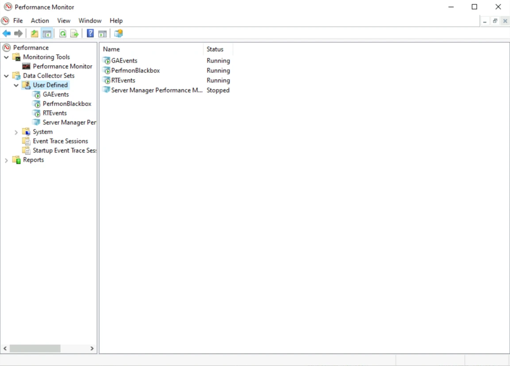
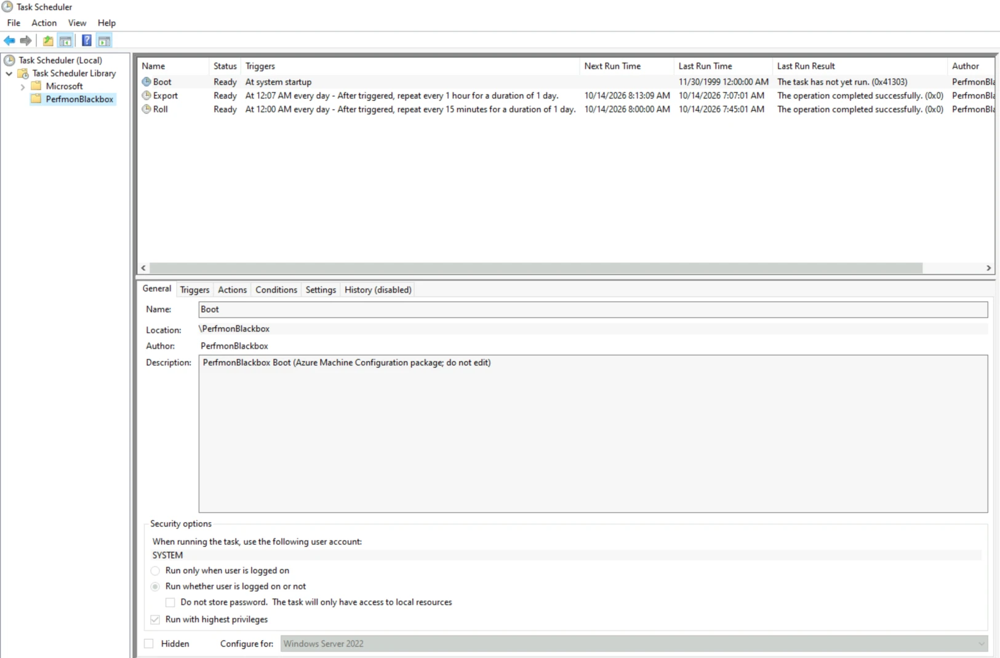
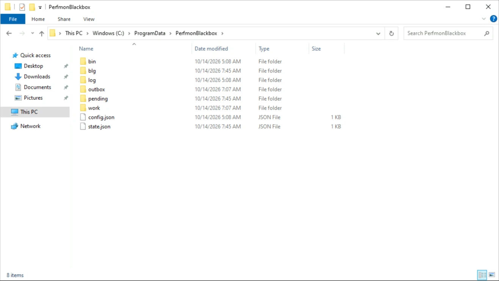
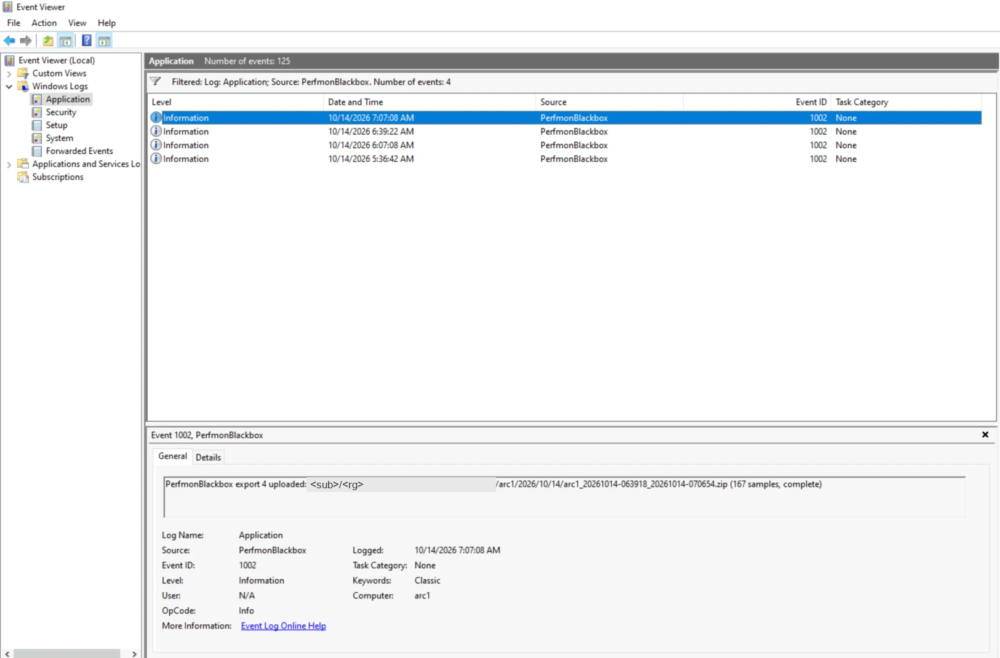

[Bölüm 2'de]() kara kutuyu kurduk: Azure Policy ve Machine Configuration her Windows sunucuya bir PerfMon kara kutusu
yerleştirdi ve her sunucu artık saatte bir, özel bir depolama hesabındaki kendi klasörüne bir zip bırakıyor. Azure
tarafından görünen de bu kadar: Compliant durumda bir guest assignment ve giderek uzayan bir zip listesi.

Bu bölümde o sunuculardan birinin içine bakıyoruz. Kara kutu, bir Windows sunucuda yalnızca işletim
sisteminin kendi araçlarıyla çalışır. Bu yazı, kaydın makine içinde nasıl tutulduğunu, yeniden başlatma ve disk
dolması gibi durumlarda nasıl davrandığını ve verinin makinenin kendi kimliğiyle özel depolamaya nasıl yüklendiğini,
Arc'a bağlı bir sunucu olan **arc1** üzerinden adım adım gösteriyor.

✅ = lab'imizde ya da playbook'un lab testlerinde doğrulandı · 📄 = yalnızca belgelere dayanıyor (Microsoft Learn,
playbook'un dokümanları ve kodu), biz test etmedik. Playbook
[VezirOrg/sreagent-playbook, `playbooks/perfmon-blackbox`](https://github.com/VezirOrg/sreagent-playbook/tree/perfmon-blackbox/v1.0.1/playbooks/perfmon-blackbox),
sürüm v1.0.1; ekran görüntüleri 2026-10-14'te arc1'den alındı, saatler UTC.

## Amaç ve hedef kitle

**Amaç.** Bu yazıyı bitirdiğinizde sunucudaki her parçanın ne işe yaradığını, bir şeyler ters gittiğinde ilk nereye
bakacağınızı ve sunucu yeniden başladığında, depolamaya ulaşılamadığında ya da disk dolduğunda kara kutunun kendi
başına ne yaptığını bileceksiniz.

**Hedef kitle.** Bölüm 2'deki kara kutuyu kullanan ya da atamayı yapmadan önce sunucularına tam olarak ne
yerleşeceğini bilmek isteyen Windows yöneticileri ve SRE'ler. Performance Monitor ve Task Scheduler'ı tanımanız yeterli.

## Ön koşullar

| Ne | Neden | |
|---|---|---|
| En az bir sunucuda bölüm 2'deki kara kutu | inceleyecek bir şey olması için | ✅ |
| O sunucuda yerel yönetici erişimi (RDP, Bastion ya da PowerShell remoting) | klasörü yalnızca SYSTEM ve Administrators grubu okuyabilir | ✅ |
| Başka bir şey gerekmiyor | aşağıdaki bütün kontroller Windows'la gelen araçlarla yapılıyor | ✅ |

## Sunucu tarafına kısa bir bakış


flowchart LR
  subgraph S["Windows sunucu (arc1), SYSTEM olarak çalışır"]
    MC["Machine Configuration<br/>7 kaynağı yerinde tutar"] -->|oluşturur, onarır| DCS["Veri toplayıcı kümesi<br/>dairesel .blg, 512 MB, 10 sn"]
    MC -->|kaydeder| T["Görevler: Boot, Roll, Export"]
    DCS -->|Roll, 15 dk'da bir:<br/>dosyayı kapatır| P["pending\\<br/>kapalı parçalar"]
    P -->|Export, N saatte bir:<br/>relog, boşluklar, manifest| Z["outbox\\<br/>tek zip"]
  end
  Z -->|HIMDS'ten token<br/>kendi kimliği, anahtar yok| ID["Entra ID"]
  Z -->|private endpoint<br/>üzerinden PUT Blob| ST[("perfmon/&lt;sub&gt;/&lt;rg&gt;/arc1/...")]


Sunucuda iki tür parça çalışır: kaydı tutan bir **veri toplayıcı kümesi** (data collector set) ve kaydı kapatan, dışa
aktaran ve yeniden başlatan üç **zamanlanmış görev**. **Machine Configuration** hepsini yerinde tutar; biri bir şeyi
değiştirirse eski hâline getirir. Her şey tek bir klasörde durur: `C:\ProgramData\PerfmonBlackbox`. 📄

## Veri toplayıcı

*Performance Monitor → Data Collector Sets → User Defined* altında `PerfmonBlackbox` kümesi Running durumunda. ✅
(Yanındaki `GAEvents` ve `RTEvents` kara kutuya değil, Azure guest agent'a ait.)



Aynı bilgi komut satırından `logman query PerfmonBlackbox` ile de alınabilir (burada aynı lab'deki Azure VM iis1'den,
kısaltılmış): ✅

```text
Name:                 PerfmonBlackbox
Status:               Running
Root Path:            %ProgramData%\PerfmonBlackbox\blg
Segment Max Size:     512 MB
Run as:               SYSTEM

Name:                 PerfmonBlackbox\Counters
Output Location:      C:\ProgramData\PerfmonBlackbox\blg\PerfmonBlackbox.blg
Circular:             On
Overwrite:            On
Sample Interval:      10 second(s)
```

Burada önemli olan **Circular** satırı. İkili dosya 512 MB'ı asla geçmez: dolduğunda en yeni örnek en eskisinin
üzerine yazılır. 📄 Playbook bunu arc1'de 16 MB'lık bir dosya ve 1 saniyelik aralıkla test etti: dosya başa döndü ve
hiç büyümedi. ✅ arc1'de 512 MB yaklaşık 25 saatlik veriye yetiyor (bölüm 2); dışa aktarımların hepsi başarısız olsa
bile kara kutu geriye dönük bu kadarını hatırlar. ✅

## Üç zamanlanmış görev

*Task Scheduler Library → PerfmonBlackbox* altında: ✅



| Görev | Ne zaman | Ne yapar |
|---|---|---|
| **Boot** | Windows'un her açılışında | yeniden başlatmadan önceki dosyayı `pending\` klasörüne taşır, açılış zamanını kaydeder, toplayıcıyı yeniden başlatır |
| **Roll** | 15 dakikada bir | toplayıcıyı durdurur, dosyayı `pending\` klasörüne taşır, yeniden başlatır (yaklaşık 3 saniye) |
| **Export** | her `ExportEveryHours` saatte bir (burada 1) | bir kez daha roll yapar, parçaları tek bir CSV'de birleştirir, bir manifest ile zip'leyip yükler |

Üçü de Windows PowerShell 5.1 ile **SYSTEM** hesabıyla çalışır; açıklamalarında "Azure Machine Configuration package;
do not edit" yazar. ✅ Birini değiştirirseniz Machine Configuration bir sonraki denetimde eski hâline getirir. 📄

**Boot görevinde "The task has not yet run (0x41303)" yazıyor.** Burada beklenen de bu: arc1 paket kurulduktan sonra
hiç yeniden başlatılmadı, dolayısıyla Boot görevinin çalışması için bir neden olmadı. ✅ Bu bir hata değil. Yeniden
başlatma testi [aşağıda](#sunucu-yeniden-başladığında).

## Klasör

arc1'de `C:\ProgramData\PerfmonBlackbox`: ✅



Her öğenin işi tek cümleyle, playbook'un kodundan ve dokümanlarından: 📄

| Öğe | Ne |
|---|---|
| `bin\` | paketin getirdiği dosyalar: görevlerin çalıştırdığı iki betik (`Start-PerfmonBlackbox.ps1`, `Export-PerfmonBlackbox.ps1`) ve `bin\collector\` altında toplayıcı şablonu ile sayaç listeleri; Machine Configuration bunları paketle birebir aynı tutar. |
| `blg\` | toplayıcının şu anda yazdığı dairesel kayıt, `PerfmonBlackbox.blg`. |
| `log\` | `perfmonblackbox.log`, kara kutunun kendi metin günlüğü: her roll, dışa aktarım, yükleme denemesi ve yeniden deneme. |
| `outbox\` | o anki dışa aktarımın yüklenmeyi bekleyen zip'i; depolama kabul edince silinir, başarısız bir yüklemeden kalan zip'in yerini bir sonraki dışa aktarımınki alır. |
| `pending\` | kaydın kapatılmış ve bir sonraki dışa aktarımı bekleyen, her biri en fazla 15 dakikalık parçaları; `20261013-174504-00-roll-m512.blg` gibi adlar her parçanın ne zaman ve neden kapatıldığını gösterir (`roll`, `export`, `boot`, `recreate`, `start`). |
| `work\` | çalışma alanı: süren bir dışa aktarımın CSV'leri ve manifest'i (çalışma bitince silinir) ile toplayıcı ve görevler için üretilen XML dosyaları. |
| `config.json` | atamanın parametreleri, bu sunucuya ulaştığı hâliyle (boyut, aralık, dışa aktarım sıklığı, depolama hesabı, container, `LocalKeepMB`); dosyayı Machine Configuration yazar. |
| `state.json` | dışa aktarımın kaldığı yer: `last_ts` (son başarılı yüklemedeki son örnek), dışa aktarım sıra numarası, kaydedilen açılış zamanları ve son hata. |

Klasöre yalnızca SYSTEM ve Administrators grubu erişebilir. 📄 İçinde gizli bilgi yok: sunucu diskte ne anahtar ne de
token tutar. 📄

## Tek bir örnekten zip'e

Roll görevi 15 dakikada bir dairesel dosyayı kapatıp `pending\` klasörüne taşır. Toplayıcı yazarken Windows dairesel
bir dosyayı okuyamaz; düzgün kapanmayan bir sunucuda da yalnızca kapatılmış dosya güvendedir. 📄 Dışa aktarım
sırasında:

1. Son dakikalar da dahil olsun diye bir kez daha **roll** yapılır.
2. Her parça `relog -q` ile **kontrol edilir**: okunabiliyor mu, kaç örnek var, hangi zaman aralığını kapsıyor?
   Okunamayan tek bir dosya bütün `relog` çağrısını başarısız kılar, o yüzden bu dosyalar ayrılır. 📄
3. Sağlam parçalar tek bir `relog … -f csv` çağrısıyla tek bir CSV'de **birleştirilir**; yalnızca `last_ts`'den
   sonraki örnekler alınır: önceki zip'le ne çakışma olur ne de boşluk kalır. 📄
4. **Her boşluk adıyla kaydedilir.** İki örnek arasında örnekleme aralığının iki katından uzun her fark, nedeniyle
   birlikte manifest'e yazılır; tek bir boşluk bile varsa `complete` false olur. 📄
5. CSV, `manifest.json` ile birlikte **zip'lenir** ve **yüklenir**; `last_ts` ancak depolama zip'i kabul ettikten
   sonra ilerler ve parçalar o zaman silinir. ✅

Manifest, zip'in künyesidir. iis1'deki ilk dışa aktarımdan gerçek bir örnek (2026-10-13, kısaltılmış; kimlik
bilgileri değiştirildi): ✅

```json
{
  "package_version": "1.0.0",
  "machine_prefix": "<sub>/<rg>/iis1",
  "identity": "imds",
  "seq": 1,
  "first_sample_utc": "2026-10-13T17:37:25.569Z",
  "last_sample_utc": "2026-10-13T18:06:54.151Z",
  "rows": 178,
  "interval_s": 10,
  "buffer_hours": 21.7,
  "processes": 114,
  "roll_seconds": 2.8,
  "sources": [
    { "name": "20261013-174504-00-roll-m512.blg",   "reason": "roll",   "rows": 46 },
    { "name": "20261013-180003-00-roll-m512.blg",   "reason": "roll",   "rows": 90 },
    { "name": "20261013-180705-00-export-m512.blg", "reason": "export", "rows": 42 }
  ],
  "gaps": [],
  "complete": true
}
```

Üç parça (15 dakikalık iki roll ve dışa aktarımın kendi roll'u), 178 örnek, boşluk yok. `"identity": "imds"`, bu Azure
VM'in token'ı nereden aldığını gösterir; arc1'de burada `himds` yazar ([aşağıda](#sunucu-kaydı-kendi-kimliğiyle-nasıl-yükler)). ✅

## Sunucu yeniden başladığında

Açılışta Boot görevi yeniden başlatmadan önceki dosyayı `pending\` klasörüne taşır, açılış zamanını `state.json`'a
yazar ve toplayıcıyı yeniden başlatır. Bir sonraki dışa aktarım açılıştan önceki ve sonraki parçaları birleştirir,
ama asla aynı `relog` çağrısında değil, çünkü PerfMon'un oran sayaçları açılıştan sonra sıfırdan başlar. Aradaki süre
manifest'e **`machine_off`** boşluğu olarak yazılır. 📄

Playbook'un lab'inde arc1 2026-10-13'te aynı paketle yeniden başlatıldı: yeniden başlatmadan önceki parçalar dışa
aktarıldı, tek boşluk 52 saniyelik bir `machine_off` oldu. Açılıştan sonraki ilk örneğin oran değeri, olması gerektiği
gibi boş. ✅

**15 dakikalık roll neden var?** Daha önceki bir sürüm tek bir dosyayı dışa aktarıma kadar açık tutuyordu. Düzgün bir
`az vm restart` bile o açık dosyayı okunamaz hâle getirdi ve yeniden başlatmadan önceki örnekler kayboldu. ✅ Artık açık
dosya en fazla 15 dakikalık veri tutuyor. Bir kapanış onu yine de okunamaz bırakırsa dosya `pending\` klasöründe kalır
ve sonraki dışa aktarımlarda yeniden denenir; üç başarısız okumadan sonra silinir, 2003 olayı yazılır ve manifest o
aralığı **`unreadable_ring`** boşluğu olarak bildirir. Veri hiçbir zaman sessizce kaybolmaz. ✅ (bir Azure VM'de test
edildi)

## Disk dolduğunda

- **Kayıt diski dolduramaz.** Dairesel dosyanın boyutu sabittir (`MaxSizeMB`). ✅
- **Dışa aktarımı bekleyen parçaların bir üst sınırı var.** `pending\` ve `outbox\` birlikte en fazla `LocalKeepMB`
  (varsayılan 1.024 MB) kullanabilir. Sınır aşılırsa önce en eski parçalar silinir, 2001 olayı yazılır ve bir sonraki
  manifest **`local_cap`** boşluğu bildirir. 📄
- **Kapasite kontrolü bundan önce uyarır.** Machine Configuration, dosyanın ve yerel sınırın kaç saatlik veri
  tuttuğunu hesaplar; dışa aktarım aralığının 1,5 katını tutmuyorlarsa guest assignment'ı NonCompliant yapar
  (`[BlackboxCapacity]` kaynağı). arc1'de gerekçe şöyle: "ring holds ~25.2 h …, LocalKeepMB holds ~50.4 h … margin ok". ✅

Başka nedenlerle zaten dolmuş bir diski test etmedik. O durumda toplayıcının ne yapacağını Windows belirler. 📄

## Depolamaya ulaşılamadığında

Token alma ya da yükleme başarısız olursa aynı çalışma içinde 5 dakika, ardından 10 dakika sonra, her seferinde yeni
bir token'la yeniden denenir. Denemelerin hiçbiri başarılı olmazsa 3002 olayı yazılır ve hiçbir şey ilerlemez:
`last_ts` ve parçalar olduğu yerde kalır; bir sonraki başarılı dışa aktarım `last_ts`'den bu yana biriken bütün aralığı
tek bir zip'le taşır. 📄 Playbook bir Azure VM'de depolamaya erişimi yaklaşık 3 dakika engelledi: yükleme bir kez
başarısız oldu, ikinci denemede başarılı oldu ve bir sonraki manifest de eksiksiz ve kesintisizdi. ✅ Kesinti
`LocalKeepMB`'ın yettiği süreden kısa olduğu sürece (arc1'de yaklaşık 50 saat) hiçbir şey kaybolmaz. ✅

## Sunucu kaydı kendi kimliğiyle nasıl yükler

Sunucuda anahtar, SAS ya da başka bir gizli bilgi yok. Export görevi `https://storage.azure.com/` için gereken Entra ID
token'ını sunucunun **system-assigned managed identity**'si üzerinden alır: 📄

- **Azure VM'de** instance metadata uç noktasından, `http://169.254.169.254/metadata/identity/oauth2/token`.
- **Arc'a bağlı sunucuda** Connected Machine agent'tan, `http://localhost:40342/metadata/identity/oauth2/token`. İlk
  çağrı 401 döndürür ve yanıtta `C:\ProgramData\AzureConnectedMachineAgent\Tokens\` altındaki bir challenge dosyasının
  yolunu verir; bu dosyayı yalnızca yöneticiler ve *Hybrid agent extension applications* grubu okuyabilir (görev SYSTEM
  olarak çalışır). İkinci çağrı dosyanın içeriğini gönderir ve token'ı alır.
  ([Learn: identity and authorization](https://learn.microsoft.com/azure/azure-arc/servers/security-identity-authorization#microsoft-entra-id-managed-identity))

Learn'deki "Azure VM üzerinde Arc sunucusunu değerlendirme" kurulumu Azure metadata uç noktasını engeller; yani arc1'in
yüklemeleri gerçekten Arc agent'ı üzerinden geçer. 📄 Playbook'un arc1'deki yükleme testi manifest'e `identity=himds`
yazdı ve "uploaded with the machine identity (himds)" sonucunu verdi. ✅

Ardından sıradan bir REST çağrısı gelir: private endpoint üzerinden `PUT Blob`. Çağrıda, depolama servisi baytları
doğrulayabilsin diye `Content-MD5` ve üç metadata değeri (`sha256`, `seq`, `complete`) bulunur. Yalnızca HTTP 201
başarı sayılır. ✅ Token yalnızca bellekte tutulur; diske ya da günlüğe hiç yazılmaz. 📄

Asıl önemli olan, bu kimliğin yetkisinin ne kadar dar olduğu. Policy her sunucuya container üzerinde **tek** bir rol
verir, *PerfMon Blackbox Writer*: yalnızca blob yazma ve ekleme; okuma, silme ya da listeleme yok. Üstelik blob yolunun
sunucunun kendi önekiyle, `<sub>/<rg>/arc1/` ile başlaması şartı var. Playbook'un testinde o önekin dışına yazma
denemesi reddedildi. ✅

## Event Viewer: ilk bakılacak yer

Bir sunucuda bir şeyler ters gidiyorsa **Event Viewer → Windows Logs → Application** günlüğünü açın ve kaynağa göre
**PerfmonBlackbox** filtresi uygulayın. ✅ arc1'de saatte bir yapılan dört dışa aktarım, dört 1002 olayı olarak
görünüyor:



| ID | Düzey | Anlamı |
|---|---|---|
| **1002** | Information | bir dışa aktarım eksiksiz yüklendi; mesajda blob adı ve örnek sayısı var |
| 1001 | Information | toplayıcı başlatıldı (açılışta ya da bir değişiklikten sonra) |
| 2002 | Warning | bir dışa aktarım yüklendi ama boşluklar var; mesaj boşlukları listeler |
| 2001 | Warning | `LocalKeepMB`'a ulaşıldı: bir parça dışa aktarılmadan silindi |
| 2003 | Warning | bir parça üç kez okunamadı ve silindi |
| 3001 | Error | toplayıcı başlatılamadı |
| 3002 | Error | bir dışa aktarım tüm denemelerden sonra başarısız oldu; bir sonraki çalışma aynı pencereyi yeniden dener |

(Playbook'un kodundan. 📄)

**İlk dışa aktarımdan önce olay yok.** `PerfmonBlackbox` olay kaynağı, kara kutunun yazdığı ilk olayla oluşur; yeni
bir sunucuda bu da ilk dışa aktarımdır. O zamana kadar Event Viewer hiçbir şey göstermez,
`Get-WinEvent -ProviderName PerfmonBlackbox` de böyle bir provider olmadığını söyler. Bu bir arıza değil: ilk dışa
aktarımı bekleyin. Dışa aktarım yerel saatle 00:07'de, ardından her `ExportEveryHours` saatte bir çalışır; her
seferinde 10 dakikaya kadar rastgele bir gecikme eklenir ([operations.md](https://github.com/VezirOrg/sreagent-playbook/blob/main/playbooks/perfmon-blackbox/docs/operations.md#events)). 📄 iis1'de ilk 1002, sunucu Compliant
olduktan 29 dakika sonra geldi. ✅

Komut satırından:

```powershell
Get-WinEvent -ProviderName PerfmonBlackbox -MaxEvents 5
```

Olaylar soruya yanıt vermiyorsa sırayla şunlara bakın: sunucuda `state.json` (`last_ts`, `last_error`) ve
`log\perfmonblackbox.log`, Azure'da guest assignment'ın gerekçeleri (bölüm 2) ve en yeni zip'in `manifest.json`'ı
(`complete`, `gaps`). 📄

## Bu yazının göstermedikleri

- **Başka nedenlerle zaten dolmuş bir disk.** Bunu test etmedik.
- **arc1'de okunamayan bir parça ya da depolama kesintisi.** İkisini de playbook bir Azure VM'de test etti; Arc'ta
  çalışan kod aynı.
- **Bu lab'de arc1'in yeniden başlatılması.** Yeniden başlatma sonucu playbook'un daha önceki lab'inden; yine arc1'de
  ve aynı paketle (v1.0.1, v1.0.0'ın zip'ini değiştirmeden kullanır).
- `logman` çıktısı ve manifest aynı lab'deki Azure VM iis1'e ait; arc1'deki aynı toplayıcı yukarıdaki ekran
  görüntüsünde görünüyor.

## Sorun giderme

| Belirti | Neden | Çözüm |
|---|---|---|
| Event Viewer'da `PerfmonBlackbox` kaynağı yok | henüz hiç dışa aktarım yapılmadı | ilk dışa aktarımı bekleyin ✅ |
| Boot görevi: "has not yet run (0x41303)" | sunucu kurulumdan beri yeniden başlamadı | bir şey yapmanız gerekmez ✅ |
| 3002 olayı ve `state.json`'da `last_error` | token ya da yükleme üç kez başarısız oldu (ağ, private endpoint'in DNS'i, Writer rolü) | bağlantıyı düzeltin; bir sonraki dışa aktarım `last_ts`'den itibaren eksiği kapatır 📄 |
| `local_cap` içeren 2002 olayı | yüklemeler `LocalKeepMB`'ın yettiğinden daha uzun süre başarısız oldu | yükleme yolunu düzeltin; daha büyük bir `LocalKeepMB` düşünün 📄 |
| `unreadable_ring` içeren 2002 olayı | bir kapanış açık parçayı okunamaz bıraktı (en fazla 15 dakika) | bir şey yapmanız gerekmez; kayıp manifest'te adıyla yazılı ✅ |
| Guest assignment `[BlackboxCapacity]` üzerinde NonCompliant | dosya ya da yerel sınır, dışa aktarım aralığının 1,5 katından az veri tutuyor | `MaxSizeMB`'ı ya da `LocalKeepMB`'ı artırın veya daha sık dışa aktarın 📄 |
| Bir görev ya da toplayıcı elle değiştirildi | Machine Configuration sapmayı düzeltir | bir şey yapmanız gerekmez; bir sonraki denetimde eski hâline döner 📄 |

## Ne öğrendik

- **Bir sunucudaki kara kutu üç görev, bir toplayıcı kümesi ve bir klasörden ibaret**; Machine Configuration da
  hepsini paketteki hâliyle tutuyor.
- **Dairesel bir dosya ancak kapatılınca güvende.** 15 dakikalık roll kaydı kapalı parçalara bölüyor; bir yeniden
  başlatma en fazla 15 dakikalık veriye mal oluyor ve manifest bunu açıkça yazıyor.
- **Her kaybın bir adı var.** Yeniden başlatma, okunamayan parça, yerel sınır ya da eksik örnek; her biri nedeniyle
  birlikte bir boşluk olarak yazılıyor ve `complete` false oluyor.
- **Sunucu kimliğini gizli bilgi olmadan kanıtlıyor.** IMDS'ten ya da Arc agent'tan alınan managed identity token'ı
  yetiyor; rolü de yalnızca kendi klasörüne yazmasına izin veriyor.
- **İlk bakılacak yer Event Viewer; ilk dışa aktarımdan önce olay görmemek normal.**

## Sırada: agent olayı inceliyor

Zip'ler depolamada ve her birinin, boşluklarını adıyla yazan bir manifest'i var. Sıra bölüm 1'in ilk satırındaki
soruda: sunucuyu ne yavaşlattı? **[Bölüm 4]()**'te Azure SRE Agent'a arc1'in saatlik kayıtlarından ikisini soruyoruz:
önce sakin bir saati, sonra bilerek yük bindirdiğimiz ve doğru cevabını önceden yazdığımız bir saati. Agent'ın neyi
bulduğuna, neyi yanlış söylediğine ve tek bir analizin kaça mal olduğuna bakıyoruz.
