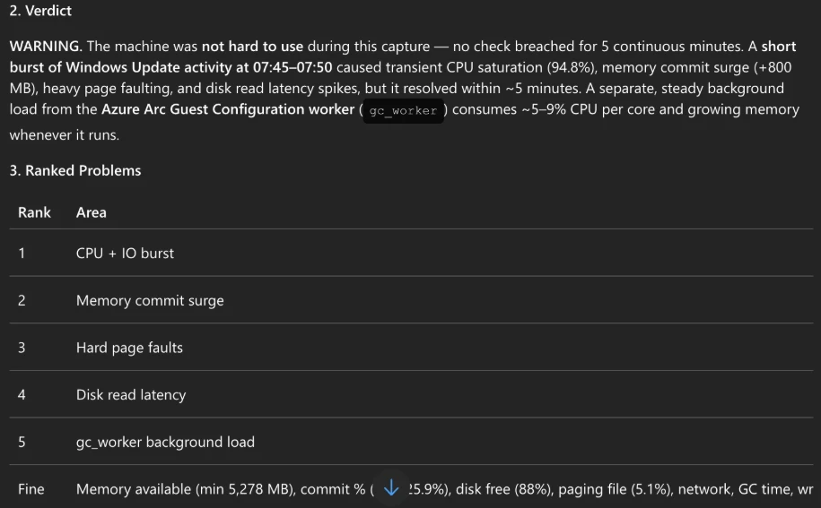
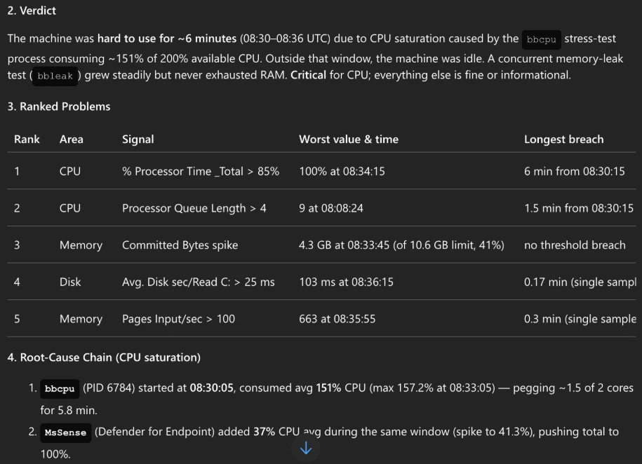

[Part 1]() opened with a server that was slow at 03:10 and no data to explain it. [Part 2]() set up the recorder, and
[part 3]() showed how it keeps the recording on the machine and uploads it every hour. This last part asks the
question the black box exists for: **what happened on this server?**

We ask Azure SRE Agent about two hours of arc1, the Arc-enabled server of parts 1 and 2. The first is a quiet hour. In
the second we **staged a problem on purpose**: a memory leak and a CPU burst, from a lab script, with the exact times
written to a file before the capture was exported. So we can check the agent's answer against the truth, line by line.
Nothing here is a real incident, and we say so wherever it matters.

✅ = proven in our lab · 📄 = documented only (Microsoft Learn, the playbook's docs and code), not tested by us. Times
are UTC, 2026-10-14.

## Goal and audience

**Goal.** You see what the agent does with a black box capture, step by step, how good its answer is against a known
truth, and what one analysis costs.

**Audience.** SREs and Windows administrators who run Azure SRE Agent or consider it, and want to know whether its
analysis of performance data can be trusted.

## Prerequisites

| What | Why | |
|---|---|---|
| The black box and the `perfmon-triage` skill from part 2 | the agent needs the captures and the skill that reads them | ✅ |
| VNet integration on the agent, resolving the storage's private endpoint | the skill downloads the zip over the private endpoint | ✅ |
| **SRE Agent Standard User** on the agent, for the person who asks | the role that may chat ([Learn: user roles](https://learn.microsoft.com/azure/sre-agent/user-roles)) | 📄 |

## How the agent works with the skill


flowchart LR
  Q["Question in a thread:<br/>analyse the latest capture of arc1"] --> A["SRE Agent<br/>picks the skill perfmon-triage"]
  A -->|perfmon_fetch_latest.py<br/>its own identity, private endpoint| ST[("perfmon/&lt;sub&gt;/&lt;rg&gt;/arc1/...")]
  ST -->|newest zip, hash and<br/>manifest checked| CSV["CSV, 360 samples"]
  CSV -->|perfmon_csv_to_sqlite.py| DB[("SQLite")]
  DB -->|perfq.py: orient,<br/>breadth, depth, link tests| R["Ranked report<br/>in the thread"]


The skill keeps raw data away from the model. The agent runs Python in its sandbox: one script downloads the newest
zip of the server and checks it against its manifest, one turns the CSV into a SQLite database, and a query library
answers the questions of a fixed checklist (CPU, memory, disk, network, processes). The model reads only the answers,
never the 360 × 1,800 numbers. 📄 In the thread this shows as about ten terminal steps, from "Phase 0: orient" to the
report. ✅

Both questions were the same sentence, each in a new thread: ✅

```text
Analyse the latest PerfMon capture of arc1. The captures are in the storage account <account>.
```

## Hour 1: a quiet hour

**The capture:** `arc1_20261014-070704_20261014-080654.zip`, complete, no gaps, 360 samples at 10 seconds. The agent
answered in about 6 minutes. ✅



**Verdict: WARNING, "not hard to use".** No check stayed over its limit for five minutes. The agent found a burst at
07:45: CPU at 94.8%, a processor queue of 31, about 800 MB more committed memory, hard page faults and a disk read
latency of 106 ms, all within the same ten seconds, and gone by about 07:50. It tied the burst to Windows Update,
because the Windows Update worker `TiWorker` appeared at 07:45:55. ✅

What to make of it:

- **We have no ground truth for this hour**, so we cannot score it. The Windows Update story is plausible, and the
  agent said itself that it rests on timing only: its link test could not run because the processes lived too briefly.
  That is the honest way to state a cause. ✅
- **It saw the black box's own manager.** The fifth item, `gc_worker` at 5–9% of a core, is the Machine Configuration
  worker, which checks the configuration every 15 minutes. 📄 The agent called it normal and gave it "info". ✅
- **It set one artefact aside**: a single 208 ms read latency sample at 07:19 with no reads around it. ✅

## Hour 2: a staged problem

**How we staged it.** The playbook's lab script `make-trouble.ps1` starts two renamed copies of Windows'
`powershell.exe` as a one-off SYSTEM task: `bbleak` allocates memory and never frees it, and `bbcpu` keeps every
logical CPU busy. Nothing is installed, and it is a lab tool, never part of the package. 📄 We ran it at half length
with a leak of 1,200 MB per hour. Its truth file, written as it ran (shortened): ✅

```json
{
  "host": "arc1",
  "cpus": 2,
  "problems": [
    { "id": "leak", "process": "bbleak", "counter": "Private Bytes",
      "per_hour_bytes": 1258291200, "from": "2026-10-14 08:25:04", "to": "2026-10-14 08:47:34" },
    { "id": "cpu", "driver": "bbcpu", "counter": "Processor Information\\% Processor Time",
      "from": "2026-10-14 08:30:04", "to": "2026-10-14 08:36:04", "minutes": 6 }
  ],
  "capture_first": "2026-10-14 08:07:04",
  "capture_last": "2026-10-14 09:06:54"
}
```

The hourly export uploaded the hour at 09:07:10, complete, no gaps. We asked at 09:10:37; the answer came at 09:17:17. ✅



**Verdict: "hard to use for ~6 minutes (08:30–08:36)", CPU critical**, with the leak as a second finding. ✅

### The report against the truth

| | Truth (staged) | The agent's report | |
|---|---|---|---|
| CPU burst, process | `bbcpu` | `bbcpu`, PID 6784, about 151% of 200% | ✅ |
| CPU burst, time | 08:30:04 – 08:36:04, 6 min | started 08:30:05, breach "6 min from 08:30:15", wound down 08:35:55 | ✅ |
| Leak, process | `bbleak` | `bbleak`, PID 704, started 08:25:04, exited about 08:47 | ✅ |
| Leak, rate | 1,200 MB per hour (1,258,291,200 bytes) | "31 MB → 548 MB at 1.3 GB/h" | ✅ close |
| Severity | a 6-minute saturation on a 2-CPU machine | CPU **critical**; memory, disk and paging "info" | ✅ |
| Anything invented | — | nothing outside the plants called a problem | ✅ |

It also named `MsSense` (Microsoft Defender for Endpoint) adding about 37% CPU during the burst. We did not plant that;
it is the real Defender on the server, reacting to a busy process, and the report puts it second in the chain. ✅

### The score: 95 of 100

The playbook scores every staged run with a fixed rubric, by script, against the truth file. 📄 This run:

| Item | Points | This run |
|---|---|---|
| The zip, the host and the capture window named | 10 + 5 + 5 | 20 |
| The leak found: `bbleak` and a growth rate within ±40% of the planted one | 30 | 30 |
| The CPU burst found: CPU and a start time within ±2 minutes, and `bbcpu` named | 30 | 30 |
| "Critical" not used for the leak alone | 5 | 5 |
| Nothing invented (no commit, paging-file, disk or network problem, none was planted) | 5 | 5 |
| **Every line with "caused by", "because" or "drives" backed by a `LINK:` line** (the skill's correlation test) | 5 | **0** |
| No raw data in the report (no line with more than 30 numbers) | 5 | 5 |
| **Total** (pass: 80 or more, every plant found) | 100 | **95, pass** ✅ |

The five points went on wording: the verdict says "CPU saturation **caused by** the `bbcpu` stress-test process",
and the report has no `LINK:` line behind it. Its own text says the link test could not run because
`bbcpu` lived for only two time buckets. The conclusion is right; the skill's rule is to say "coincides with" until a
link test backs a cause. ✅

## What one analysis costs

The two arc1 analyses used 34 and 37 Azure Agent Units (AAU), and a staged analysis of iis1 the day before about 35. ✅ At
the official price that is **roughly 3.5 to 5 USD per deep-dive analysis, depending on region**, about 3.9 USD in
Sweden Central. The price table, the always-on cost and a worked example for 10 and 100 servers are in
[part 2](). 📄

## What this test does not show

- **A real incident.** The load was staged, and its process names (`bbcpu`, `bbleak`) gave a lot away: the agent
  even called them "stress-test binaries". A real problem does not name itself.
- **More than one hour, one machine, one question.** A real investigation often spans several captures; the skill can
  fetch a time range, which the playbook tested separately. 📄
- **How the agent does on an unknown cause.** That is the next test: a real, anonymised 24-hour capture whose cause
  nobody knows, in a separate post.

## Troubleshooting

| Symptom | Cause | Fix |
|---|---|---|
| The agent cannot list or download the zip | no VNet integration, or the private DNS does not resolve the account | VNet integration with private DNS resolution (part 2) 📄 |
| 403 when the skill reads the container | the reader role went only to the agent's user-assigned identity; its terminal signs in as the system-assigned one | give the reader role to both identities (part 2, step 1) ✅ |
| The skill finds no capture for a new server | the first export has not run yet | wait for the first export (part 3) 📄 |
| The report says "complete: false" | the manifest names gaps (restart, local cap, unreadable piece) | read the gaps; part 3 explains each cause ✅ |

## What we learned

- **The agent found both staged problems with the right times and rates**, and ranked the 6-minute CPU saturation as
  the thing that made the machine hard to use. 95 of 100.
- **Its one miss was wording, not substance**: a cause stated without the link test the skill asks for.
- **On a quiet hour it stayed calm**: "not hard to use", a brief Windows Update burst, and the black box's own
  manager listed as background.
- **The skill keeps the model away from raw data**, and an analysis costs about 35 AAU, roughly 3.5 to 5 USD.
- **A staged test proves the path, not the judgement.** The judgement on an unknown cause is the next post.

## The series in one paragraph

[Part 1]() showed why a server needs its recorder running before the problem, not after. [Part 2]() installed a PerfMon flight recorder on Windows servers with nothing but Azure Policy and Machine
Configuration, and showed what it costs. [Part 3]() opened the server: one collector, three tasks, one folder, a
manifest that names every gap, and an upload with the server's own identity. This part asked Azure SRE Agent what
happened, and checked its answer against a truth we wrote down first. The next time a server is slow at 03:10, the
data is there.
